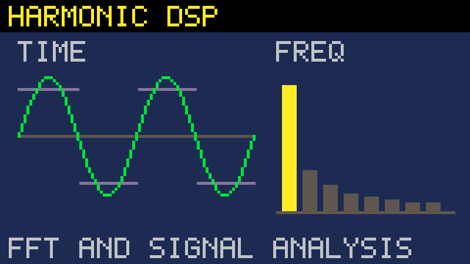

# Harmonic DSP

Browser-based Fourier and DSP toolkit for aerospace engineering: FFT, harmonic synthesis, STFT, Welch PSD, aliasing, blade-pass analysis.



No install: it runs in the browser with no backend. Open the live demo below.

**Live demo:** https://aboutkvs.vercel.app/fourier_enhanced.html

### Fourier Analysis and Digital Signal Processing Toolkit for Aerospace Engineering

**Harmonic DSP** is an interactive, browser-based signal analysis engine built to explore Fourier analysis, digital signal processing, and their applications in aerospace engineering.

The project started from a simple question: *what actually happens to an engineering signal when we move between the time and frequency domains?*

Instead of treating the FFT as a black-box function, Harmonic DSP lets you interact with the mathematics behind it. You can generate signals, add noise, change sampling conditions, inspect harmonics, reconstruct waveforms, visualize phase, study spectral leakage, demonstrate aliasing, and move into more practical analysis such as STFT, Welch PSD, blade pass frequency analysis, and flutter-related frequency response.

Everything runs directly in the browser with **zero backend infrastructure**.

> **Note on this repository:** this repo is documentation only. The actual implementation (HTML/CSS/JS) lives in my [personal portfolio site repo](https://github.com/shanthoshkv/shanthoshkv.github.io) as `fourier_enhanced.html` and is deployed at the link below. There is no local source to clone and run from here yet.

## Live Demo

**Website:** https://aboutkvs.vercel.app/fourier_enhanced.html

---

## What This Project Does

Harmonic DSP combines fundamental Fourier analysis with practical signal-processing tools commonly encountered in aerospace, turbomachinery, vibration analysis, structural health monitoring, and experimental engineering.

The main analyser allows an arbitrary mathematical expression in `t` to be entered and analysed interactively.

For example:

```text
sin(2*pi*t)
```

or more complex signals containing multiple frequency components.

The analyser then provides:

* Time-domain waveform
* Magnitude spectrum
* Phase spectrum
* Individual harmonic components
* Harmonic reconstruction
* Cumulative energy capture
* Parseval error
* Sampling frequency
* SNR
* THD
* Crest factor
* Peak annotations
* Signal envelope

Several engineering-oriented presets are also included, such as square waves, sawtooth waves, triangle waves, aero flutter signals, blade-pass signals, amplitude-modulated signals, and a Gibbs phenomenon demonstration.

---

# Core Features

## 1. Fourier Series Analysis

The project begins with the mathematical foundation of Fourier analysis.

A periodic signal can be represented as:

$$
x(t)=\frac{a_0}{2}+\sum_{n=1}^{\infty}
\left[
a_n\cos\left(\frac{2\pi nt}{T}\right)
+
b_n\sin\left(\frac{2\pi nt}{T}\right)
\right]
$$

The analyser makes this decomposition visual rather than purely theoretical.

You can increase or decrease the number of harmonics and immediately observe how the reconstructed waveform changes.

This is particularly useful for understanding why complex periodic signals can be represented using relatively simple sinusoidal components.

---

## 2. Cooley-Tukey FFT

The frequency-domain analysis uses an in-place radix-2 Cooley-Tukey FFT implementation.

The conventional DFT has computational complexity:

$$
O(N^2)
$$

while the FFT reduces this to:

$$
O(N\log_2N)
$$

For a 4096-point transform, the theoretical operation count drops dramatically compared with directly evaluating the DFT.

The implementation exposes the actual FFT workflow rather than relying entirely on a high-level black-box spectrum library.

---

## 3. Magnitude and Phase Spectrum

The analyser separates the complex FFT output into magnitude and phase.

Magnitude:

$$
|X[k]|=\sqrt{\operatorname{Re}(X[k])^2+\operatorname{Im}(X[k])^2}
$$

Phase:

$$
\angle X[k]=\operatorname{atan2}
\left(
\operatorname{Im}(X[k]),
\operatorname{Re}(X[k])
\right)
$$

This makes it possible to study not only which frequencies are present, but also how their phase relationships contribute to the reconstructed signal.

---

## 4. Harmonic Reconstruction

One of the main visual features is harmonic synthesis.

Individual harmonic components are displayed together with their cumulative reconstruction, making it possible to see how a complex waveform emerges from sinusoidal components.

For example, a square wave can be reconstructed using only its odd harmonics:

$$
x(t)=\frac{4}{\pi}
\sum_{n=1,3,5,\ldots}
\frac{\sin(2\pi nt/T)}{n}
$$

Increasing the harmonic count progressively sharpens the waveform.

---

## 5. Parseval Energy Verification

The analyser includes a Parseval consistency check between the time and frequency domains.

For a discrete signal:

$$
\sum_n |x[n]|^2
=
\frac{1}{N}
\sum_k |X[k]|^2
$$

The application calculates the relative error between the two energy estimates.

This provides a useful numerical sanity check for the transform implementation and demonstrates that signal energy is preserved when moving between domains.

---

# Advanced DSP Tools

## Phasor Animator

The phasor visualizer represents individual Fourier components as rotating vectors.

Each vector rotates at its corresponding harmonic frequency, while the vector sum produces the resulting waveform.

This gives an intuitive geometric interpretation of Fourier synthesis.

It is particularly useful for understanding why adding more harmonics causes a square wave to progressively approach its discontinuous shape.

---

## STFT Spectrogram

The Short-Time Fourier Transform allows frequency content to be analysed as it changes with time.

Instead of obtaining only:

```text
frequency
```

the STFT produces:

```text
time × frequency
```

information.

This is useful for transient and non-stationary signals where a conventional FFT cannot adequately represent when a frequency component occurs.

The implementation provides controls for:

* Window size
* Hop size
* Total duration
* Signal expression
* Colour map

---

## Aliasing Demonstrator

The aliasing tool provides an interactive demonstration of the Nyquist-Shannon sampling criterion.

The basic requirement is:

$$
F_s > 2f_{max}
$$

The application compares the true continuous signal with the sampled signal and visualizes the resulting alias when the sampling frequency is insufficient.

The aliased frequency is calculated as:

$$
f_{alias}
=
\left|
f_{signal}
-
\operatorname{round}
\left(
\frac{f_{signal}}{F_s}
\right)F_s
\right|
$$

This has a direct aerospace relevance because inadequate sampling can cause vibration, acoustic, or structural health monitoring systems to report completely incorrect frequency content.

---

## Cross-Correlation

Cross-correlation is included for estimating the relative delay between two signals.

The tool accepts two signals and calculates:

$$
R_{xy}(\tau)
$$

The peak of the cross-correlation provides an estimate of the time delay between the signals.

This has applications in experimental measurements, sensor synchronization, propagation-delay estimation, and system identification.

---

# Research and Engineering Tools

## Welch Power Spectral Density

The project implements Welch's method for estimating power spectral density.

Instead of calculating a single periodogram, the signal is divided into overlapping segments, windowed, transformed, and averaged.

This reduces the variance of the PSD estimate and provides a more stable representation of broadband and vibration-related signals.

The analyser reports:

* Peak frequency
* Number of segments
* Frequency resolution
* Noise floor
* PSD in dB/Hz

This is particularly relevant to vibration analysis and structural health monitoring.

---

## Aerospace Blade Pass Frequency Calculator

The project includes a dedicated turbomachinery analysis tool for calculating Blade Pass Frequency.

The fundamental relationship is:

$$
f_{BPF}
=
\frac{RPM}{60}
N_{blades}
$$

The harmonic series is:

$$
f_k=kf_{BPF}
$$

The tool also calculates rotor-stator interaction tones when stator vane information is provided.

This connects the mathematical Fourier analysis directly to turbomachinery applications.

For a rotating component, the FFT of pressure, acceleration, acoustic, or other sensor data can reveal blade-pass tones and their harmonics.

---

## Flutter Margin Analysis

A dedicated analysis section is included for exploring frequency response and flutter-related behaviour.

The tool accepts parameters such as:

* Natural frequency
* Damping ratio
* Excitation frequency
* Modal FFT expression

The goal is to connect frequency-domain analysis with the type of vibration behaviour encountered during aerospace structural testing and flight-test data analysis.

---

# Signal Quality Metrics

The core analyser calculates several useful engineering metrics.

### SNR

Signal-to-noise ratio provides an estimate of the relative strength of the useful signal compared with noise.

### THD

Total Harmonic Distortion provides a measure of harmonic content relative to the fundamental component.

### Crest Factor

Crest factor compares the peak amplitude with the RMS value and can provide useful information about impulsive or highly peaked signals.

These metrics make the project more useful for actual signal characterization rather than limiting it to frequency visualization.

---

# Window Functions

Several windowing methods are supported:

* Rectangular
* Hanning / Hann
* Hamming
* Blackman
* Flat-top
* Kaiser

Windowing is important because finite-length measurements can introduce spectral leakage when the sampled interval does not contain an integer number of signal periods.

For example, the Hann window is:

$$
w[n]
=
0.5
\left(
1-\cos\left(\frac{2\pi n}{N-1}\right)
\right)
$$

The project allows the effect of different windows on the frequency spectrum to be explored interactively.

---

# Gibbs Phenomenon

The Gibbs phenomenon is demonstrated using a dedicated preset.

When a Fourier series approximates a discontinuous signal, increasing the number of harmonics reduces the width of the oscillatory region but does not completely eliminate the characteristic overshoot.

For an ideal square wave, the overshoot approaches approximately:

$$
8.9\%
$$

of the jump.

This provides a useful visual connection between Fourier theory and the behaviour of real truncated series.

---

# Data Export

The analyser can export analysis results as a structured CSV file.

The export can contain:

* Time-domain samples
* Frequency-domain magnitude
* Phase spectrum
* Sampling frequency
* Signal period
* Number of samples
* Window function
* Parseval error
* SNR
* THD
* Crest factor
* Analysis metadata

The exported structure is designed to be convenient for further analysis in:

* Python
* MATLAB
* Excel
* Pandas
* Engineering signal-processing workflows

This makes the application useful as a preprocessing and exploration tool rather than only as a visualization.

---

# Aerospace Applications

Fourier analysis is everywhere in aerospace engineering.

Some of the applications that motivated this project include:

### Turbomachinery

Blade Pass Frequency and its harmonics can be identified from pressure, acoustic, and vibration measurements.

### Structural Health Monitoring

Changes in modal frequencies and vibration signatures can indicate structural changes or damage.

### Flutter Analysis

Frequency-domain analysis of accelerometer and pressure data can help identify dynamic behaviour and stability margins.

### Aeroacoustics

Fan and turbofan noise contains strong tonal components associated with rotational and blade-passing frequencies.

### Experimental Measurements

FFT, PSD, cross-correlation, and STFT are useful for analysing data from accelerometers, microphones, pressure sensors, strain gauges, and other experimental instrumentation.

### Sampling and Data Acquisition

The aliasing demonstrator highlights why sensor sampling rates must be selected carefully when measuring high-frequency aerospace phenomena.

---

# Technical Architecture

The application is intentionally lightweight.

```text
User Input
    │
    ▼
Expression Parser
    │
    ▼
Signal Generation
    │
    ├── Time Domain
    │
    ├── Windowing
    │
    ▼
Cooley-Tukey FFT
    │
    ├── Magnitude Spectrum
    ├── Phase Spectrum
    ├── Harmonics
    └── Energy Analysis
         │
         ├── STFT
         ├── Welch PSD
         ├── Cross-Correlation
         └── Engineering Analysis
                 │
                 ├── BPF
                 └── Flutter
```

The application is designed to operate entirely in the browser.

There is no server-side signal-processing pipeline required.

---

# Technology Stack

* HTML5
* CSS3
* JavaScript
* math.js
* Canvas-based visualizations
* Cooley-Tukey FFT
* STFT
* Welch PSD
* Numerical signal processing

The application uses the browser as the computational environment, making the tool immediately accessible without installing MATLAB, Python, or a dedicated DSP package.

---

# Project Roadmap

The project was developed in three major phases.

### Phase 1: Core Engine

* Expression parser
* FFT
* Magnitude spectrum
* Phase spectrum
* Harmonic synthesis
* Parseval verification
* Window functions
* Noise injection
* SNR
* THD
* Crest factor
* Cumulative energy
* Signal envelope
* Aerospace signal presets

### Phase 2: Advanced DSP

* Phasor animation
* STFT spectrogram
* Aliasing demonstrator
* Cross-correlation
* Selectable visualization settings

### Phase 3: Research Tools

* Welch PSD
* Industry-oriented CSV export
* Turbofan BPF calculator
* Flutter margin estimator

All three development phases are currently implemented.

---

# Why I Built This

Fourier analysis is usually introduced through equations and then immediately hidden behind an FFT function.

I wanted to build something where the mathematics remained visible.

Instead of simply calculating:

```python
fft(signal)
```

and looking at a plot, the project tries to show the relationship between the original signal, its harmonics, its frequency-domain representation, its phase, and its reconstructed waveform.

The aerospace-specific tools were added to bridge the gap between textbook DSP and the kind of signal analysis that appears in real engineering work.

The result is a small browser-based laboratory for exploring Fourier analysis from both a mathematical and engineering perspective.

---

# Learning Goals

This project was also an exercise in understanding:

* Fourier series
* DFT and FFT
* Complex frequency-domain representations
* Spectral leakage
* Window functions
* Sampling theory
* Aliasing
* Harmonic synthesis
* Parseval's theorem
* STFT
* PSD estimation
* Cross-correlation
* Turbomachinery frequency analysis
* Aerospace vibration analysis

The main objective was not just to make a visually impressive FFT plot, but to understand what the algorithms are actually doing and why the results matter.

---

## Author

**Shanthosh K V**

Aerospace Engineering Student
RV College of Engineering, Bengaluru

Interested in aerospace propulsion, turbomachinery, CFD, experimental research, computational engineering, and the intersection of engineering with machine learning.

---

## License

This project is intended primarily as an educational and engineering exploration tool.

© 2025 Shanthosh K V
